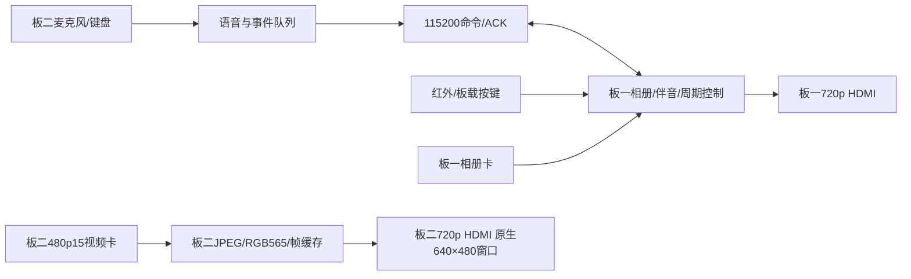

# 交付内容与入口

| 目录 | 收录内容 |
|---|---|
| 00_firmware_current | 仅 8EB7D133 与 6F5DD197 两个当前选择的 bit |
| 01_board1 | 全部生产 RTL/辅助 RTL、TD 工程与 IP、引脚/时钟约束、构建/发布脚本、仿真平台、日志、报告、基线记录 |
| 02_board2 | 视频/语音/通信 RTL、JPEG 解码器、工程与 IP、构建/发布/媒体脚本、300 帧素材、C 比较数据、仿真、构建报告与验证资料 |
| 03_media | 当前480p15配套原始卡镜像、软件预览；板一示例相册及相片/制作脚本 |
| 04_tools | 包校验、隔离测试入口、PCM/MD01采样工具、卡格式与媒体制作工具 |
| 05_docs | 操作入口、当前接线、构建/测试、目录索引、GitHub交付结构参考 |
| 06_validation | 新版源/bit/测试/媒体绑定检查、打包时复现入口检查 |
| 07_dependencies | 外部相册夹具、对端通信 RTL、音频测试向量、测试卡前缀、JPEG独立C模型、依赖映射 |
| 08_licenses | 本地JPEG许可、素材来源、组件使用说明 |
| 09_package_audit | 复制来源逐文件清单、组装/校验脚本、打包事实、GitHub目录元数据 |

## 工程入口

- 板一 TD 工程：`01_board1/src/td_project/HX4S20C_Extensions.al`。
- 板一引脚/时钟约束：`01_board1/src/user_source/constraints_source`。
- 板一周期逻辑：`01_board1/src/user_source/hdl_source/SD/sd_card_bmp.v`。
- 板一构建：`01_board1/tools/build_video.py` 与 `01_board1/build.tcl`。
- 板二 TD 工程：`02_board2/project/HX4S20C_Extensions.al`。
- 板二引脚/时钟约束：`02_board2/src/pin.adc`、`02_board2/src/timing.sdc`。
- 板二顶层：`02_board2/src/top.v`；语音/通信：`02_board2/src/voice`；视频：`02_board2/src/mjpeg_video_player.v`、`video_source.v`、`video_path.v`。
- 板二构建：`02_board2/build.py` 与 `02_board2/build.tcl`。

## 文件校验与依赖

工程、媒体和验证资料具有逐文件 SHA256 清单。来源索引见 `09_package_audit/PROVENANCE.json`，文本修订及代码内容一致性校验见 `09_package_audit/TEXT_REVISION.json`。临时编译目录由隔离复现入口生成。

TD、ModelSim、GCC、FFmpeg 安装程序属于外部工具依赖；安装路径和版本要求见 [BUILD_AND_TEST.md](BUILD_AND_TEST.md)。临时路径可由 `portable_runners.py` 的工作副本重建。
